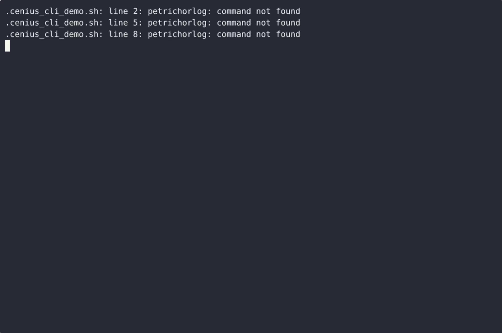
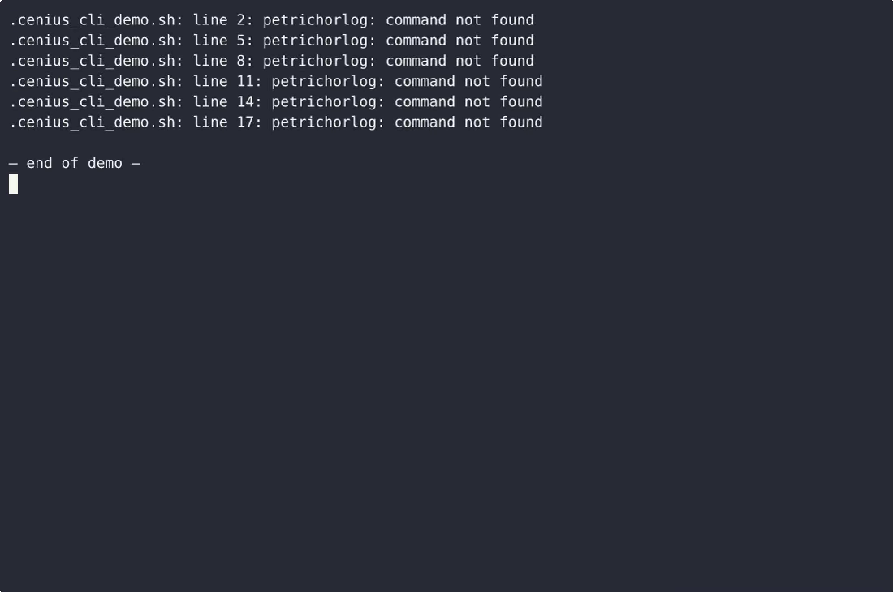

# PetrichorLog — complete Full-stack app pet command-line tool example app

**PetrichorLog** is a free, open-source pet command-line tool written in Full-stack app. PetrichorLog is a single-file, standard-library-only Python CLI that lets one person log rain events (local date/time, duration, millimetres, notes), rate each storm on a documented 0-5 Petrichor intensity scale, atta…. Every PetrichorLog file — code, design, seeded demo data — ships in this repository under the Apache-2.0 license. Self-host it, or [remix PetrichorLog on cenius.ai](https://cenius.ai/marketplace/p/petrichorlog?ref=gh&utm_campaign=petrichorlog-webapp) to get a custom build with full rebrand rights.


[](LICENSE)  [](https://cenius.ai)

[](https://cenius.ai/marketplace/p/petrichorlog?ref=gh&utm_campaign=petrichorlog-webapp)

> **▶ [Open & edit in cenius.ai](https://cenius.ai/marketplace/p/petrichorlog?ref=gh&utm_campaign=petrichorlog-webapp)** — one click to an editable workspace: describe changes in plain English, get an instant preview, one-click deploy and host. Modifications made on the platform come with full rebrand & relicense rights.

_Local clone? See [Quick start](#quick-start) below. cenius.ai is the zero-setup path._

## Demo


▶ **[Video walkthrough](https://cenius.ai/marketplace/p/petrichorlog?ref=gh&utm_campaign=petrichorlog-webapp)** — see the app in action on the cenius.ai project page · [MP4 file](.github/media/demo.mp4)

## Screenshots

 

## Quick start

```bash
./install.sh   # installs dependencies + seeds demo data
```

See [`INSTALL.md`](INSTALL.md) for full setup and usage instructions.

## Architecture

A self-contained Full-stack app project (13 files): top-level directories include `tests/`. One command (`./install.sh`) covers dependency setup and demo-data seeding. For environment-specific setup, see [`INSTALL.md`](INSTALL.md).

## Features

- Log a rain event
- Petrichor intensity scale
- Soil moisture notes
- List, inspect and correct events
- Seasonal pattern visualizer

## Usage guide

Every command is run as `python3 petrichorlog.py …` (or `petrichorlog …` after
`bash install.sh`). `--store PATH` and `--passphrase-stdin` may be written before
or after the subcommand.

```
petrichorlog [--version] [--store PATH] [--passphrase-stdin] COMMAND …
    log add     log a rain event (wizard, or flags)
    log list    list events, newest first
    log show    full detail for one event
    log note    append a soil-moisture reading
    log season  monthly seasonal pattern for a year
```

### Log a rain event

Flag mode never prompts and never blocks:

```bash
python3 petrichorlog.py log add --rain 4 --minutes 30 --intensity 3
python3 petrichorlog.py log add --start 09:00 --minutes 30 --rain 8.5 \
    --notes "smell arrived ten minutes after the first drops"
python3 petrichorlog.py log add --start 09:00 --end 10:30 --rain 2.5
```

* `--start` takes `HH:MM` (today) or ISO-8601 (`2025-06-14T09:00`); blank = now.
* `--minutes` **or** `--end` — never both. `--end` `HH:MM` lands on the same local
  day as the start and must be later; use ISO-8601 for a window that crosses
  midnight. Duration is the ceiling of `(end - start) / 60` minutes.
* `--rain` is millimetres (default 0), `--intensity` is 0-5 (default: suggested).

Interactive mode — run it with no flags — walks the same fields with prompts,
prints the whole intensity scale, and re-asks on a bad value instead of exiting:

_Full guide: [`USAGE.md`](USAGE.md)_

## FAQ

### Can I deploy PetrichorLog on my own infrastructure?

Clone this repository and run `./install.sh`, then start the app as described in [`INSTALL.md`](INSTALL.md). PetrichorLog is fully self-hostable — no external services are required to try it.

### Can I rebrand or white-label PetrichorLog?

Yes. The MIT license lets you remove the original branding and ship under your own name. For a guided approach, [remix it on cenius.ai](https://cenius.ai/marketplace/p/petrichorlog?ref=gh&utm_campaign=petrichorlog-webapp): you get a fresh build with full rebrand and relicense rights.

### Can non-developers customise PetrichorLog?

[cenius.ai](https://cenius.ai/marketplace/p/petrichorlog?ref=gh&utm_campaign=petrichorlog-webapp) handles the implementation. Tell it what you want in everyday words, pick up the updated build. No coding needed.

### Which technology stack does PetrichorLog use?

The app is built with Full-stack app. What you see in this repo is the full production source, demo data included. Highlights include list, inspect and correct events.

### Does the PetrichorLog license allow commercial use?

Yes — it ships under the Apache-2.0 license, which permits commercial use, modification and redistribution. The full text is in [LICENSE](LICENSE).

## License & rebranding

Released under the [Apache License 2.0](LICENSE) (© 2026 Cenius AI) — free for personal and commercial use. The Cenius name/logo are trademarks (see NOTICE).

**Need a customized version?** [Remix this app on cenius.ai](https://cenius.ai/marketplace/p/petrichorlog?ref=gh&utm_campaign=petrichorlog-webapp) — modifications made on the platform come with **full rebrand & relicense rights** over your derivative.

## Built with cenius.ai

This entire application — code, design, seeded demo data — was generated on **[cenius.ai](https://cenius.ai)** from a plain-English description.

- 🚀 [Build your own app on cenius.ai](https://cenius.ai)
- 🎛️ [Remix PetrichorLog on the marketplace](https://cenius.ai/marketplace/p/petrichorlog?ref=gh&utm_campaign=petrichorlog-webapp) — open it in a workspace, prompt for changes, and ship your own version.

More open-source apps: [the Cenius-ai catalog](https://github.com/Cenius-ai) · [showcase index](https://github.com/Cenius-ai/showcase)
